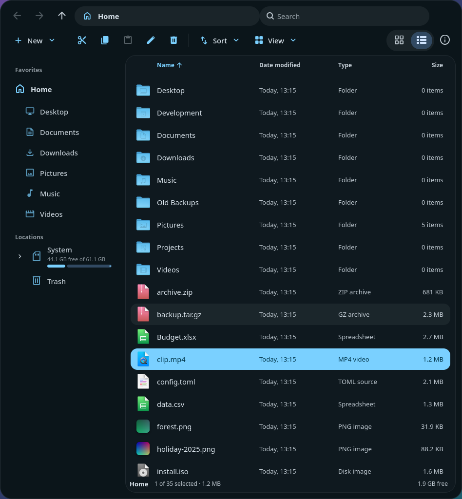

# Files

A fast, Material 3–styled file manager written in Rust with [Slint](https://slint.dev).



## Build & run

```sh
cargo run --release -- [dir]
```

## Install (Linux)

```sh
./install.sh
```

Installs the binary to `~/.local/bin`, plus the desktop entry and icon.

## Developer aids

`FILES_SHOT=out.png [FILES_ACT=a,b] files [dir]` renders the window to a PNG and quits.

## License

Google Sans is bundled under the OFL (see `assets/GoogleSans-OFL.txt`).
